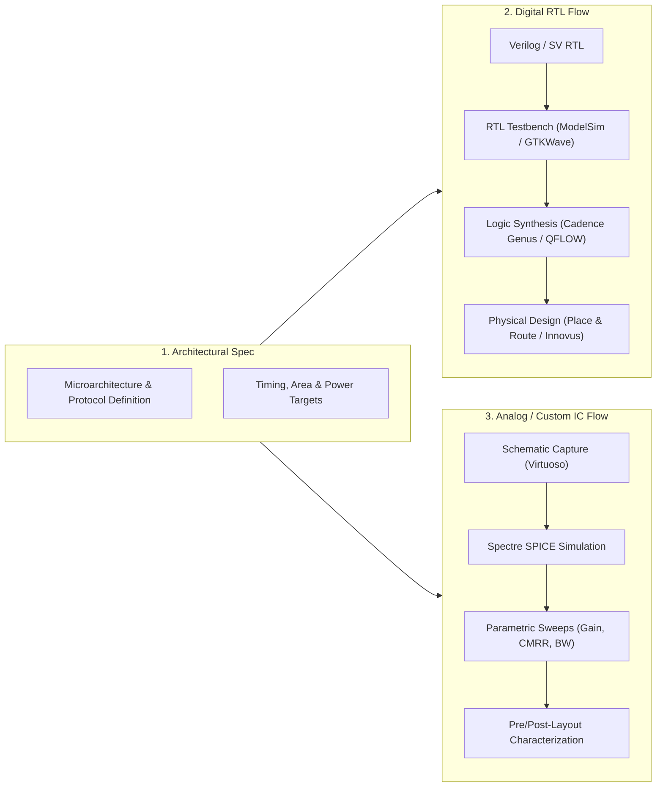

 

### Electronics Engineering | VLSI Design and Technology | RTL • FPGA • ASIC

*“Turning logic into silicon, one bit at a time.”*

---

## 🔬 About Me

I am a final-year undergraduate pursuing my **B.Tech in Electronics Engineering with a specialization in VLSI Design and Technology** at **Vellore Institute of Technology (VIT Chennai)**, graduating in **2027** (*CGPA: 8.65 / 10.0*).

My technical journey centers on understanding and designing silicon systems across both the digital and analog domains:
- **Digital RTL & Architecture:** Translating architectural specifications into synthesizeable Verilog/SystemVerilog, microarchitecting pipelined processor datapaths, and resolving clock-domain crossing (CDC) hazards.
- **Hardware Acceleration:** Designing modular cryptographic arithmetic units, specifically Post-Quantum Cryptography (PQC) hardware primitives targeting the NIST FIPS 203 (ML-KEM-512) standard.
- **Analog & Mixed-Signal IC:** Designing CMOS operational transconductance amplifiers (OTAs) and biopotential front-ends with sub-micron transistor sizing, noise optimization, and cell stability analysis.
- **Design Automation:** Developing Perl and Tcl/Tk scripts to accelerate CAD and synthesis flows, reducing turnaround time during iterative design loops.
- **Beyond the Transistor:** When away from waveforms and timing reports, I channel strategic pattern recognition into competitive chess.

---

## 🛠️ Technical Skill Matrix

<table>
  <tr>
    <td width="22%"><strong>RTL & Digital Design</strong></td>
    <td>
      
      
      
      
      
      
    </td>
  </tr>
  <tr>
    <td><strong>Computer Architecture</strong></td>
    <td>
      
      
      
      
      
    </td>
  </tr>
  <tr>
    <td><strong>Analog & Custom IC</strong></td>
    <td>
      
      
      
      
      
      
    </td>
  </tr>
  <tr>
    <td><strong>EDA & Verification Suites</strong></td>
    <td>
      
      
      
      
      
      
      
      
      
      
    </td>
  </tr>
  <tr>
    <td><strong>Automation & Scripting</strong></td>
    <td>
      
      
      
      
      
      
    </td>
  </tr>
  <tr>
    <td><strong>Hardware Research Focus</strong></td>
    <td>
      
      
      
      
      
    </td>
  </tr>
</table>

---

## ⚙️ Engineering Design Methodology

---

## 🚀 Featured Hardware Projects

### 01. ML-KEM-512 Post-Quantum Cryptography Hardware Accelerator
**Domain:** Hardware Security • Cryptographic Accelerator • Final-Year Core Project  
**Status:** In Active RTL Development & Module Verification  
[🔗 Repository](YOUR_MLKEM_REPOSITORY_URL)

> **Context:** With quantum computation threatening classical asymmetric key exchanges (RSA, ECC), the National Institute of Standards and Technology standardized Module-Lattice-Based Key-Encapsulation Mechanism (**ML-KEM**, NIST FIPS 203). Because polynomial lattice arithmetic and sponge permutations are computationally heavy for embedded microcontrollers, hardware coprocessor acceleration is critical.

🔍 <strong>Deep Dive: Architecture, Datapath & System Integration</strong>

 

* **Problem Statement:** Standard software implementations of ML-KEM-512 suffer from high execution latency on resource-constrained embedded nodes due to repetitive $256$-degree polynomial ring operations over $\mathbb{Z}_q$ ($q = 3329$) and Keccak permutations.
* **Architectural Scope & Modules:**
  * **Sponge Function Primitives:** Verilog implementation of `Keccak-f[1600]` state permutation core to execute `SHAKE-128` and `SHAKE-256` extended output functions (XOF) for matrix generation and pseudorandom seed expansion.
  * **Polynomial Arithmetic Unit:** Modular datapath implementing forward and inverse **Number Theoretic Transform (NTT / INTT)** for $O(n \log n)$ polynomial multiplication over $\mathbb{Z}_{3329}$, alongside modular addition, subtraction, Barrett/Montgomery reduction stages, and polynomial compression/decompression units.
  * **Sampling Subsystems:** RTL logic for Centered Binomial Distribution (`CBD`) sampling from uniform pseudorandom byte streams.
  * **System-on-Chip Interface:** Architecture target involves memory-mapped register attachment to a 32-bit **RISC-V PicoSoC / PicoRV32** system at base address `0x03000000` via a dedicated bus interface.
* **Current Implementation State:**
  * `[Implemented & Verified]` Keccak round permutations and polynomial modular reduction arithmetic testbenches.
  * `[Under Verification]` Pipelined NTT butterfly units and coefficient memory address generator.
  * `[Planned]` Full memory-mapped integration with PicoRV32 test harness and top-level timing closure evaluation.
* **Design Philosophy:** Prioritizing modular datapath partitioning to allow independent verification of mathematical correctness against reference test vectors prior to top-level chip integration.

---

### 02. Five-Stage Pipelined RISC-V Processor Core (RV32I)
**Domain:** Processor Microarchitecture • Digital RTL Design  
**Tools:** Verilog HDL, ModelSim / QuestaSim, GTKWave  
[🔗 Repository](YOUR_RISCV_REPOSITORY_URL)

> **Summary:** Implemented a single-hart 32-bit RISC-V processor implementing the RV32I base integer instruction set with a classical five-stage pipeline, hardware hazard resolution, and cycle-accurate functional verification.

🔍 <strong>Deep Dive: Microarchitecture & Hazard Mitigation Logic</strong>

 

* **Pipeline Structure:** Classical five-stage organization:
  1. `IF` (Instruction Fetch): Program counter generation, instruction memory interface.
  2. `ID` (Instruction Decode & Register Fetch): Dual-read register file, immediate decoding.
  3. `EX` (Execute & ALU): Arithmetic/logical datapath, branch target generation.
  4. `MEM` (Memory Access): Data memory read/write control with byte/halfword alignment.
  5. `WB` (Write Back): Multiplexed destination write-back to the register file.
* **Hazard Resolution Mechanisms:**
  * **Data Hazards (RAW):** Implemented an EX/MEM-to-EX and MEM/WB-to-EX **forwarding unit** to eliminate pipeline stalls on register dependencies across consecutive arithmetic instructions.
  * **Load-Use Dependencies:** Integrated hazard detection logic that inserts an automated single-cycle pipeline bubble/stall and holds the PC and IF/ID pipeline registers when an execution operand depends directly on an unresolved memory load.
  * **Control Hazards:** Flush unit clearing speculative `IF` and `ID` stages upon branch evaluation in the execute stage, reloading the correct non-sequential PC.
* **Verification Flow:** Comprehensive self-checking Verilog testbench exercising arithmetic operations, data memory dependency chains, nested branches, and tight hazard sequences. Waveforms inspected and validated in ModelSim and GTKWave.

---

### 03. Parameterized Asynchronous FIFO with Clock-Domain Crossing (CDC)
**Domain:** Asynchronous Logic • Clock-Domain Crossing • Verification  
**Tools:** Verilog HDL, ModelSim, GTKWave  
[🔗 Repository](YOUR_ASYNC_FIFO_REPOSITORY_URL)

> **Summary:** Designed a robust, fully parameterized asynchronous dual-clock FIFO buffer engineered to transfer streaming data reliably across uncorrelated read and write clock domains without data corruption or pointer ambiguity.

🔍 <strong>Deep Dive: CDC Architecture & Boundary Handling</strong>

 

* **Problem Statement:** Transferring multi-bit binary pointers directly across asynchronous clock domains causes race conditions due to multi-bit bus skew, leading to corrupted pointer states and undetected buffer underflows/overflows.
* **Microarchitecture Details:**
  * **Gray-Coded Pointer Conversion:** Read and write address pointers are encoded in Gray code so that only a single bit toggles per memory increment, mitigating multi-bit transition ambiguity.
  * **Metastability Mitigation:** Pointers are transferred across domains using dual-flip-flop synchronizers (two-flop synchronization stages), dampening metastability settlement failures.
  * **Status Flag Computation:** Full generation logic computed in the write clock domain using synchronized read pointers; Empty flag calculated in the read clock domain using synchronized write pointers.
* **Verification Scope:** Rigorous boundary testing under highly asymmetric clock frequencies (e.g., $f_{clk\_write} \gg f_{clk\_read}$ and $f_{clk\_read} \gg f_{clk\_write}$), back-to-back burst transfers, continuous simultaneous read/write cycles, and full/empty boundary edge cases verified in ModelSim/GTKWave.

---

### 04. Low-Power, Low-Noise CMOS ECG Analog Front-End IC
**Domain:** Analog IC Design • Biopotential Amplifiers • Custom Silicon  
**Tools:** Cadence Virtuoso Schematic Editor, Cadence Spectre Simulation Platform  
[🔗 Repository](YOUR_ECG_FRONTEND_REPOSITORY_URL)

> **Summary:** Designed a high-precision CMOS analog front-end (AFE) circuit targeted for biopotential electrocardiogram (ECG) acquisition, characterized through rigorous transistor-level SPICE simulations.

🔍 <strong>Deep Dive: Topology & Characterized Simulation Results</strong>

 

* **Architecture:**
  * **Instrumentation Amplifier (IA):** Custom differential stage designed to amplify sub-millivolt cardiac potentials while suppressing DC electrode-offset voltages.
  * **Two-Stage Operational Transconductance Amplifier (OTA):** Miller-compensated high-gain core providing high output swing and driving capability.
  * **Driven Right Leg (DRL) Circuit:** Active common-mode feedback circuit that senses common-mode body noise and injects an inverted cancelation current back to the patient body model to suppress 50/60 Hz mains interference.
  * **Body Impedance Modeling:** Simulated with an equivalent RC body-electrode network.
* **Confirmed Simulation Metrics (Reported from Virtuoso / Spectre):**
  * **Differential Gain:** `79.5 dB`
  * **Common-Mode Rejection Ratio (CMRR):** `113.5 dB`
  * **Bandwidth:** `34 kHz`
* **Transistor Optimization:** Systematic parametric sweeping of transistor aspect ratios ($W/L$) across input differential pairs to balance low-frequency flicker (1/f) noise reduction against DC open-loop gain and current consumption.

---

### 05. 8×8 In-Memory Computing 6T SRAM Array
**Domain:** Memory Architecture • In-Memory Computing (IMC) • SPICE Characterization  
**Tools:** Cadence Virtuoso, SPICE Netlisting & Simulation  
[🔗 Repository](YOUR_SRAM_REPOSITORY_URL)

> **Summary:** Exploratory custom IC design of an $8\times8$ 6-Transistor (6T) SRAM memory core capable of performing localized boolean logic and arithmetic directly on the bitlines, minimizing the memory-access bottleneck.

🔍 <strong>Deep Dive: Memory Cell Topology & In-Memory Logic Operations</strong>

 

* **Motivation:** In conventional Von Neumann architectures, the energy and latency overhead of shuttling data between the memory hierarchy and the arithmetic execution unit dominates total power. In-Memory Computing performs computations directly within the memory fabric.
* **Design Features:**
  * Transistor-level design of an $8 \times 8$ array of balanced 6T SRAM memory cells, wordline decoders, bitline conditioning circuitry, and precharge circuits.
  * Exploited simultaneous multi-wordline activation to perform in-situ analog-domain boolean operations (bitwise **AND**, **OR**, and primitive **ADD** logic) via voltage division on the bitlines.
* **Characterization & Stability Analysis:**
  * Conducted Static Noise Margin (**SNM**) analysis to evaluate read, write, and hold margins.
  * Validated cell stability against bitline disturbance under dual-wordline activation conditions via pre-layout and post-layout SPICE simulations.

---

### 06. FPGA Feed-Forward Neural Network Accelerator & Automation Flow
**Domain:** Reconfigurable Computing • Digital Datapath • EDA Automation  
**Tools:** Verilog HDL, FPGA Flow, Perl, Tcl/Tk  
**Status:** In Development (Hardware Core) • Automated Flow Operational  
[🔗 Repository](YOUR_FPGA_NN_REPOSITORY_URL)

> **Summary:** A parameterized fixed-point neural network inference engine targeting FPGA deployment, integrated with a scripted automation framework that significantly cuts iterative compilation and verification loops.

🔍 <strong>Deep Dive: Architecture & Scripted Automation Framework</strong>

 

* **Accelerator Concept (In Progress):** Parameterized Verilog datapath comprising pipelined multiply-accumulate (MAC) processing elements, fixed-point quantization, and hardware activation function evaluation for low-latency edge inference.
* **EDA Flow Automation (Operational Achievement):**
  * Developed custom **Perl and Tcl scripts** to fully automate the design lifecycle: source file tracking, automated testbench batch runs, synthesis script generation, constraint application, and log/timing parsing.
  * **Empirical Engineering Metric:** Achieved a verified **70% reduction in iteration turnaround time** compared to manual GUI-based synthesis and verification iterations.

---

### 07. Fabric-Based Flexible Piezoresistive Pressure Sensor
**Domain:** Flexible Electronics • Transducer Materials • Interdisciplinary Engineering  
**Tools:** Material Characterization, Piezoresistive Data Acquisition Setup  
[🔗 Repository](YOUR_PRESSURE_SENSOR_REPOSITORY_URL)

> **Summary:** Interdisciplinary hardware and materials project developing a wearable piezoresistive pressure sensor using nanomaterial-coated conductive textiles for tactile and biometric sensing.

🔍 <strong>Deep Dive: Material Composition, Tuning & Response Metrics</strong>

 

* **Operating Principle:** Transduces mechanical strain and contact force into measurable electrical resistance shifts through contact area deformation across conductive nanomaterial networks.
* **Composition & Fabrication Tuning:**
  * Coated flexible fabric substrates with a blend of **Reduced Graphene Oxide (RGO)** and **Carbon Nanotubes (CNT)**, stabilized with **PEDOT:PSS**.
  * Systematically iterated material ratios to optimize sheet conductivity, mechanical adhesion, and dynamic range, converging on an optimal **2:3 RGO:CNT blend ratio**.
* **Characterized Results:**
  * **Dynamic Response Time:** Approximately **~17 ms** response time demonstrated under rapid loading/unloading cycles.
  * Successfully captured biomechanical motion waveforms during finger-bending, wrist-articulation, and calibrated mechanical load tests.

---

### 08. Physical Design of SPI Block via QFLOW
**Domain:** ASIC Physical Design Flow • Place & Route • Synthesis  
**Tools:** QFLOW Open-Source Toolchain (Yosys, Graywolf, Qrouter, Magic)  
[🔗 Repository](YOUR_NETLIST_TOOL_REPOSITORY_URL)

> **Summary:** Hands-on implementation of the full RTL-to-GDSII physical design flow for a Serial Peripheral Interface (SPI) IP block as part of structured VLSI training at Maven Silicon.

🔍 <strong>Deep Dive: RTL-to-Layout ASIC Flow Stages</strong>

 

* **Design Methodology:**
  1. **RTL Synthesis:** Logic synthesis of the Verilog SPI core using Yosys to map behavioral code into target standard cell gate primitives.
  2. **Floorplanning & Placement:** Boundary pin assignment, power grid network definition, and standard cell placement using Graywolf.
  3. **Clock Tree & Routing:** Detailed multi-layer routing with Qrouter to achieve global and local interconnections.
  4. **Design Rule & Layout Extraction:** Layout verification and geometric checks using Magic VLSI.
* **Engineering Insight:** Practical exposure to the interplay between logical design, timing constraints, cell density, and routing congestion closure.

---

## 🔬 Additional Engineering Tools & Experiments

- **Netlist Partitioning Automation:** Python utility developed to parse structural netlists and apply graph partitioning algorithms for modular sub-block isolation during large-scale CAD exploration. [Repository placeholder / In Progress]
- **Embedded Sensor DAQ Modules:** Modular microcontroller-based data acquisition nodes (Arduino UNO, MPU6050 6-DoF IMU, BMP280 barometric sensor, NEO-6M GPS) developed for physical transducer testing and telemetry capture.

---

## 💼 Experience

#### **Maven Silicon** — *Camp Intern (VLSI Design & Physical Flow)*
*June 2025 – July 2025 | Bengaluru, India*
- Executed hands-on ASIC physical design flows for digital subsystems (SPI block) utilizing the open-source QFLOW toolchain.
- Participated in bi-weekly technical sessions focusing on synthesis, static timing analysis (STA) fundamentals, floorplanning, placement, and clock tree routing.

#### **Smart Link Holdings** — *Quality Assurance Engineer*
*June 2025 – July 2025 | Margao, Goa, India*
- Performed structured QA testing of software and embedded tooling modules against detailed technical requirement specifications.
- Logged, isolated, and tracked defects through lifecycle resolution in close coordination with development teams.

---

## 🎯 Current Research Focus & Technical Pursuits

- [x] **Post-Quantum Cryptographic Hardware:** Completing modular datapath verification for polynomial ring arithmetic and NTT acceleration (FIPS 203 ML-KEM-512).
- [x] **Clock-Domain Crossing (CDC) Reliability:** Deepening functional coverage patterns and structural synchronization strategies for multi-clock SoCs.
- [x] **Low-Power Analog CMOS Topologies:** Exploring sub-threshold biasing and low-noise operational amplifier techniques for ultra-low-power biomedical sensing.
- [x] **EDA Scripting & Flow Automation:** Expanding reusable Tcl/Tk and Perl automation harnesses for repeatable simulation and synthesis flows.

---

## 📬 Connect & Collaborate

| Platform | Direct Link |
| :--- | :--- |
| **LinkedIn** | [linkedin.com/in/YOUR_LINKEDIN_URL](YOUR_LINKEDIN_URL) |
| **Email** | [vinayak.salunke2025@gmail.com](mailto:vinayak.salunke2025@gmail.com) |
| **GitHub** | [github.com/dracovishman](https://github.com/dracovishman) |
| **Portfolio** | [YOUR_PORTFOLIO_URL](YOUR_PORTFOLIO_URL) |

 

  "In silicon we trust; all others must bring waveforms." • Built with clean Markdown, SVG &amp; Semiconductor Discipline

